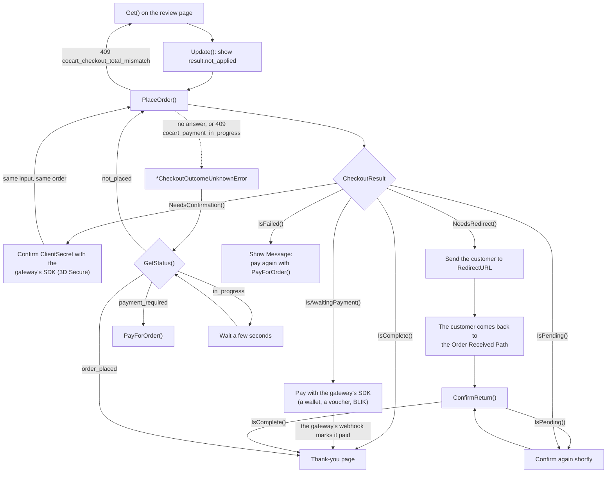

# Checkout

> Requires **CoCart Plus 2.0** and at least one WooCommerce payment gateway.

Checkout turns the customer's cart into an order and takes payment. Your Go code runs on the server, so **card details never reach it**:
- The browser collects the card with the gateway's own JavaScript (for Stripe, Stripe.js with your publishable key) and gives you a payment method ID.
- You place the order with that ID. `payment_data` carries gateway tokens only (`pm_…`, a saved method's ID), never card numbers.

- [How It Works](#how-it-works)
- [Quick Start](#quick-start)
- [Showing the Checkout](#showing-the-checkout)
- [Placing the Order](#placing-the-order)
- [Reading the Result](#reading-the-result)
- [3D Secure in the Page](#3d-secure-in-the-page)
- [Paying Outside the Checkout](#paying-outside-the-checkout)
- [Off-Site Steps](#off-site-steps)
- [Saved Payment Methods](#saved-payment-methods)
- [The Thank-You Page](#the-thank-you-page)
- [Paying for an Unpaid Order](#paying-for-an-unpaid-order)
- [Address Autocomplete](#address-autocomplete)
- [Errors Before Payment](#errors-before-payment)
- [When No Answer Comes Back](#when-no-answer-comes-back)
- [Changing a Subscription's Payment Method](#changing-a-subscriptions-payment-method)

## How It Works

1. **The cart.** The customer fills it as usual ([Cart](cart.md)).
2. **The review page: `Get`.** Show the checkout from `Checkout().Get()`. CoCart Plus remembers the total it showed, so call `Get` for the page the customer reviews, not just before placing the order.
3. **Changes: `Update`.** Save the addresses, the shipping method, the payment method or a coupon. Show what wasn't applied (`result.not_applied`).
4. **The browser turns the card into a payment method ID** with the gateway's JavaScript.
5. **`PlaceOrder`** creates the order and takes payment.
6. **Act on the result:**

   | Result | What to do |
   |---|---|
   | `IsComplete()` | Show the thank-you page (`GetOrderReceived`) |
   | `IsAwaitingPayment()` | The order is placed; the customer pays with the gateway's SDK (a wallet, a voucher, BLIK…) |
   | `NeedsConfirmation()` | The browser confirms the card (3D Secure), then you make the same call again |
   | `NeedsRedirect()` | Send the customer off-site, then call `ConfirmReturn` when they're back |
   | `IsPending()` | The gateway hasn't confirmed yet: confirm again shortly |
   | `IsFailed()` | Show `Message`; pay again with `PayForOrder` |

7. **Lost answer, or `cocart_payment_in_progress`:** `PlaceOrder` returns `*CheckoutOutcomeUnknownError`, and `GetStatus` says how it ended: `payment_required` → `PayForOrder`; `in_progress` → ask again; `not_placed` → place it again. See [When No Answer Comes Back](#when-no-answer-comes-back).
8. **`409 cocart_checkout_total_mismatch`:** the total changed since the review page. Get the checkout again and show the new total.

The whole flow, including the lock CoCart Plus takes so that a double tap, or a request sent again, can't take payment twice:



The client never sends `PlaceOrder()` again by itself after a timeout, since it may already have run on the store.

The client uses the customer's cart session. On a server, use **one client per customer**: a client holds one customer's cart key or login.

```go
client := cocart.NewClient("https://your-store.com",
	cocart.WithCartKey(cartKey), // or cocart.WithJWTToken(token)
)
```

## Quick Start

In the browser, with Stripe.js and your **publishable** key:

```js
const stripe = Stripe('pk_test_…');
const elements = stripe.elements({ mode: 'payment', amount: 2500, currency: 'eur', paymentMethodCreation: 'manual' });
elements.create('payment').mount('#payment-element');

// On submit:
await elements.submit();
const { paymentMethod, error } = await stripe.createPaymentMethod({ elements });
// POST paymentMethod.id to your server
```

On your server:

```go
func placeOrder(w http.ResponseWriter, r *http.Request) {
	result, err := client.Checkout().PlaceOrder(r.Context(), map[string]any{
		"billing_address": map[string]any{
			"first_name": "Jane",
			"last_name":  "Doe",
			"address_1":  "1 Main Street",
			"city":       "Paris",
			"postcode":   "75001",
			"country":    "FR",
			"email":      "jane@example.com",
		},
		"shipping_method": "flat_rate:1",
		"payment_method":  "stripe",
		"payment_data":    map[string]any{"wc-stripe-payment-method": r.FormValue("payment_method_id")},
	})
	if err != nil {
		// The store refused the order before taking payment: see Errors Before Payment.
		return
	}

	if result.IsComplete() {
		http.Redirect(w, r, fmt.Sprintf("/thank-you?order=%d&key=%s", result.OrderID, result.OrderKey), http.StatusSeeOther)
		return
	}
	// ...
}
```

## Showing the Checkout

The checkout as it stands, like a receipt. Call it for the page the customer reviews before paying: CoCart Plus remembers the total it showed, and refuses the order if the total has changed by then (`409 cocart_checkout_total_mismatch`). Don't call it just before placing the order.

```go
checkout, err := client.Checkout().Get(ctx)

checkout.Get("items")                     // each item with its price, quantity and totals
checkout.Get("coupons")
checkout.GetString("totals.total", "")    // "2300" (minor units)
checkout.Get("total_lines")               // [{key, label, amount, detail}] in display order
checkout.Get("payment.needs_payment")     // false when the order is free
checkout.Get("customer.billing")          // the addresses, each with "formatted"
checkout.Get("delivery.needs_shipping")
checkout.Get("delivery.packages")         // each package with its "rates" and "chosen_rate"
checkout.Get("actions")                   // what can be done next

// Optional parameters: another currency, amounts formatted for display, no product thumbnails
checkout, err = client.Checkout().Get(ctx, map[string]string{"currency": "EUR", "formatted": "true", "thumb": "false"})
```

Save what the customer has entered so far, without placing the order. It returns the checkout, with what it did in `result`:

```go
checkout, err := client.Checkout().Update(ctx, map[string]any{
	"billing_address": map[string]any{"country": "FR", "postcode": "75001"},
	"shipping_method": "flat_rate:1",
	"coupon_code":     "SAVE10",
	"coupon_action":   "apply", // or "remove"
})

checkout.GetString("result.code", "") // "checkout_updated", or "checkout_partly_updated"
notApplied, _ := checkout.Get("result.not_applied").([]any)
for _, n := range notApplied {
	item := n.(map[string]any)
	fmt.Println(item["field"], item["code"], item["message"]) // shipping_method cocart_invalid_shipping_method The shipping method "local_pickup:999" is not available.
}
```

Both addresses are checked before either is saved, and every field at fault is reported at once: see [Every Field at Fault](error-handling.md#every-field-at-fault). When nothing could be applied, it's an error and nothing changes.

The store's form settings. No cart needed:

```go
config, err := client.Checkout().GetConfig(ctx)

config.Get("fields.billing")                     // the fields, sorted by priority
config.Get("countries")
config.GetString("order_received_url", "")       // where gateways send the customer back
config.Get("address_autocomplete.enabled")       // whether SearchAddresses works
config.Get("address_autocomplete.providers")     // [{id, name}]
config.GetString("store.terms_text", "")         // plain text
config.Get("store.terms_links")                  // [{text, url}]: the words in terms_text that link to a page
config.Get("store.terms_url")                    // or nil without the page
config.Get("store.privacy_url")                  // or nil without the page
```

The payment methods for this cart, as `{"payment_methods": [...]}`:

```go
methods, err := client.Checkout().GetPaymentMethods(ctx)
list, _ := methods.Get("payment_methods").([]any)
for _, m := range list {
	method := m.(map[string]any)
	fmt.Println(method["id"], method["title"]) // stripe Credit card
}
```

Each method has `supports` (`tokenization`, `save_payment`, `refunds`, `subscriptions`) and the customer's `saved_tokens`. Shipping methods are in the checkout's `delivery.packages`.

## Placing the Order

```go
result, err := client.Checkout().PlaceOrder(ctx, map[string]any{
	"billing_address":  billing,
	"shipping_address": shipping, // when it differs from billing
	"shipping_method":  "flat_rate:1",
	"customer_note":    "Leave at the door",
	"payment_method":   "stripe",
	"payment_data":     map[string]any{"wc-stripe-payment-method": paymentMethodID},
})
```

| Field | Notes |
|---|---|
| `billing_address` | `first_name`, `last_name`, `address_1`, `city`, `postcode`, `country` and `email` at least, plus what `GetConfig` marks required |
| `shipping_address` | Same fields, when shipping goes elsewhere |
| `shipping_method` | A rate ID from the checkout's `delivery.packages` |
| `payment_method` | A gateway ID: `stripe`, `woocommerce_payments`, `paypal`, `bacs`, `cod`…; leave it out for a free order |
| `payment_data` | What the gateway needs, as a map (below) |
| `customer_note` | Optional |
| `create_account`, `customer_password` | Create an account for a guest, when the store allows it |
| `checkout_id` | Optional: 16 to 64 letters, digits, `-` or `_`. Left out, a random one is sent. See [When No Answer Comes Back](#when-no-answer-comes-back) |

`payment_data` holds the keys the WooCommerce gateway reads. They're gateway tokens only: never put card numbers in it.

| To… | Key | Value |
|---|---|---|
| Charge a new Stripe card | `wc-stripe-payment-method` | The payment method ID (`pm_…`) |
| Charge a new WooPayments card | `wcpay-payment-method` | The payment method ID |
| Charge a saved method | `wc-{gateway}-payment-token` | The saved method's `ID` |
| Save the new card for later | `wc-{gateway}-new-payment-method` | `true` |

Offline gateways (`bacs`, `cheque`, `cod`) need no `payment_data`. A free order (`payment.needs_payment` is `false`) needs neither `payment_method` nor `payment_data`. Calling `PlaceOrder` again for the same cart updates the same order rather than creating a second one.

## Reading the Result

`PlaceOrder` returns the order, with what the payment did in `result`. The SDK reads it into a `*CheckoutResult`:

```go
switch {
case result.IsComplete():
	// Paid, free, or held for review or offline payment: show the thank-you page.
case result.IsAwaitingPayment():
	// Placed but not paid yet: the customer pays with the gateway's SDK now.
case result.NeedsConfirmation():
	// The card needs 3D Secure in the page.
case result.NeedsRedirect():
	// The payment needs an off-site step.
case result.IsPending():
	// The gateway hasn't confirmed yet: confirm again shortly.
default: // result.IsFailed()
	fmt.Println(result.Message)   // "Your card was declined."
	fmt.Println(result.ErrorCode) // "card_declined"
}
```

`CheckoutResult` is the same for `PlaceOrder`, `PayForOrder`, `ConfirmReturn` and `Account().UpdateSubscriptionPaymentMethod()`:

| Field / method | Meaning |
|---|---|
| `Code` | `result.code`: `cocart.PaymentOrderPlaced` (`"order_placed"`), `PaymentActionRequired`, `PaymentPending`, `PaymentFailed`, or `PaymentMethodChanged` for a subscription. A `PaymentResultCode` string, so other values come through as they are. A response without one reads as `PaymentFailed`, never as complete |
| `IsComplete()` | `order_placed` (or `payment_method_changed`) with nothing left to do: no `action` |
| `IsAwaitingPayment()` | `order_placed` with an `action`: the order is placed and the customer still pays ([Paying Outside the Checkout](#paying-outside-the-checkout)) |
| `NeedsConfirmation()` | `action_required` with a `ClientSecret`: an in-page step |
| `NeedsRedirect()` | `action_required` with only an off-site address: send the customer to `RedirectURL` |
| `IsPending()` | `payment_pending`: the gateway hasn't confirmed yet |
| `IsFailed()` | `payment_failed` |
| `Object` | `"order"`, or `"subscription"` after a subscription's payment method change |
| `OrderID`, `OrderKey`, `OrderNumber`, `OrderStatus` | The order (`id`, `key`, `number`, `status.code`), when `Object` is `"order"` |
| `SubscriptionID` | The subscription's ID, when `Object` is `"subscription"` |
| `RedirectURL` | With `action_required`, the off-site step; otherwise the page to show once the payment is done (the order-received page, or the gateway's own). Only ever an `https` or `http` address: anything else in the response (a `javascript:` URL, another app's link) is left out |
| `ClientSecret`, `IntentType` | For [3D Secure in the page](#3d-secure-in-the-page) (`payment_intent` or `setup_intent`), and payments made in the page |
| `PaymentMethodType` | For `IsAwaitingPayment()` with Stripe: `cashapp`, `wechat_pay`, `boleto`, `oxxo` or `multibanco` |
| `Message` | For the customer, for every code: why the payment failed, or that the order was received |
| `ErrorCode` | CoCart's code to branch on (below), with `payment_failed` |
| `GatewayErrorCode`, `GatewayMessage` | The gateway's own code and message, for your logs |
| `ActionType`, `ActionData` | What the customer must do, as the gateway integration names it (`stripe_confirm_payment`, `stripe_voucher_payment`, `stripe_blik_confirmation_pending`…), and what it needs |
| `Response` | The raw `*Response`: the order, or the subscription |

`Message` and `GatewayMessage` are plain text. Show them as text (`html/template` escapes them), never as HTML.

Printing a result with `%v`, `%+v` or `%#v` leaves out `ClientSecret` and `OrderKey`, so a logged result doesn't leak them. Don't log `Response` or `ActionData`, which hold them.

| `ErrorCode` | Meaning |
|---|---|
| `card_declined` | Declined, including for fraud |
| `insufficient_funds` | Not enough funds |
| `expired_card` | The card has expired |
| `incorrect_cvc`, `incorrect_number`, `incorrect_postcode` | Wrong details |
| `authentication_failed` | 3D Secure failed or was cancelled |
| `processing_error` | The gateway had a problem; try again |
| `payment_method_not_supported`, `amount_not_supported` | The gateway can't take this payment |
| `payment_failed` | The gateway didn't say why |

A declined card is a `200` with `payment_failed`, read as a result, not an error. The order stays unpaid: `PayForOrder` takes another payment for it.

## 3D Secure in the Page

Send `result.ClientSecret` to the browser and confirm it with Stripe.js. Then make the same call again with the same input; it completes the same order.

```go
if result.NeedsConfirmation() {
	json.NewEncoder(w).Encode(map[string]string{"client_secret": result.ClientSecret})
	return
}
```

```js
const { error } = await stripe.handleNextAction({ clientSecret });
if (!error) {
  // Ask your server to place the order again.
}
```

## Paying Outside the Checkout

With some payment methods the order is placed before the customer pays, so `IsAwaitingPayment()` is `true` rather than `IsComplete()`. The cart has already been emptied, and the gateway's webhook marks the order paid: don't place the order again.

- **With `ClientSecret`** (Stripe's Cash App Pay, WeChat Pay, Boleto, OXXO and Multibanco): send `ClientSecret`, `PaymentMethodType` and `RedirectURL` to the browser, and pay with the Stripe.js call for `PaymentMethodType`, as the Stripe gateway's own checkout does. It shows a QR code, sends the customer to Cash App on a phone (and back to `RedirectURL`), or shows the voucher.
- **Without one**, `ActionType` says what to show: `stripe_blik_confirmation_pending` (the customer approves in their banking app), bank transfer instructions, a Pix or ticket from Mercado Pago, Mollie's bank transfer details. `ActionData` holds what the action needs.

| `PaymentMethodType` | Stripe.js call |
|---|---|
| `cashapp` | `confirmCashappPayment(clientSecret, { return_url })`, or `confirmCashappSetup()` for a `seti_…` secret (a free trial) |
| `wechat_pay` | `confirmWechatPayPayment(clientSecret, { payment_method_options: { wechat_pay: { client: 'web' } } })` |
| `boleto`, `oxxo`, `multibanco` | `confirmBoletoPayment(clientSecret)`, `confirmOxxoPayment()` or `confirmMultibancoPayment()` |

`GetStatus()` says `payment_required` until the payment goes through, then `order_placed`. A voucher is paid later, at a bank or a shop. If the customer gives up, the order stays unpaid, and `PayForOrder()` takes another payment for it.

## Off-Site Steps

```go
if result.NeedsRedirect() {
	http.Redirect(w, r, result.RedirectURL, http.StatusSeeOther)
	return
}
```

The customer comes back to your thank-you page: the **Order Received Path** set in CoCart Plus under Settings → Checkout (`/checkout/order-received/{order_id}/` by default), on your **Front-end site URL**. Serve that path, and hand the URL to `ConfirmReturn` there. If the setting changes, change your route to match:

```go
result, err := client.Checkout().ConfirmReturn(r.Context(), r.URL.String())

switch {
case result.IsComplete():
	// Show the thank-you page.
case result.IsPending():
	// Not confirmed yet: show "processing" and call ConfirmReturn again shortly.
default:
	// Declined or cancelled: show result.Message and offer PayForOrder.
}
```

`ConfirmReturn` reads the order ID (`order_id`) and key (`key`) from the URL, forwards every query parameter, and sends the order key in the body. It's safe to call more than once. If your route carries the order elsewhere, use `ConfirmReturnFor(ctx, orderID, orderKey, r.URL.Query())`.

`GetConfig()` gives the URL customers come back to as `order_received_url`, e.g. `https://shop.example.com/order/{order_id}?key={order_key}&order_id={order_id}`, so you know which route (or, in an app, which link) to handle.

A subscription's payment method change can send the customer off-site too (a bank, for example). They come back the same way, and the same return call finishes the change: the result's `Object` is `"subscription"`, with `SubscriptionID`, and `Code` is `PaymentMethodChanged` once the new payment method is set.

## Saved Payment Methods

A logged-in customer's saved payment methods, from `GetPaymentMethods`' `saved_tokens`:

```go
methods, err := client.Checkout().GetSavedPaymentMethods(ctx, "") // "" for every gateway, or "stripe"

for _, method := range methods {
	method.ID                    // 7
	method.GatewayID             // "stripe"
	method.Label                 // "Visa ending in 4242"
	method.Type                  // "CC"
	method.Expires               // "12/2030", or "" when it has no expiry
	method.IsDefault
	method.SupportsSubscriptions // the gateway can charge renewals (supports.subscriptions)
}
```

Pay with one with `"payment_data": map[string]any{"wc-stripe-payment-token": method.ID}`. To save a new card, add `"wc-stripe-new-payment-method": true`. A guest has none.

## The Thank-You Page

```go
order, err := client.Checkout().GetOrderReceived(ctx, orderID, orderKey)

order.GetString("number", "")         // "1234"
order.GetString("status.label", "")   // "Processing" ("status.code" is "processing")
order.Get("items")
order.Get("total_lines")              // [{key, label, amount, detail}] in display order
order.Get("payment.needs_payment")    // true if the customer still has to pay

// Amounts formatted for display, and only the meta keys you need
order, err = client.Checkout().GetOrderReceived(ctx, orderID, orderKey, map[string]string{
	"formatted": "true",
	"meta_keys": "gift_message",
})
```

A wrong key, or someone else's order, is `404 cocart_order_not_found`.

## Paying for an Unpaid Order

```go
result, err := client.Checkout().PayForOrder(ctx, orderID, orderKey, map[string]any{
	"payment_method": "stripe",
	"payment_data":   map[string]any{"wc-stripe-payment-method": paymentMethodID},
})
```

The order key is sent in the body, not the URL. It returns the same `CheckoutResult` as `PlaceOrder`, and you read it the same way:

- a declined card is `result.IsFailed()`, not an error;
- a card that needs 3D Secure gives `result.NeedsConfirmation()`: confirm it as in [3D Secure in the Page](#3d-secure-in-the-page), then call `PayForOrder` again;
- an off-site step gives `result.NeedsRedirect()`.

An order that needs no payment is `409 cocart_order_no_payment_needed`, one that can't be paid `409 cocart_order_invalid_status`, and another payment still running for it `409 cocart_payment_in_progress`. All three are `*CoCartError`.

## Address Autocomplete

```go
found, err := client.Checkout().SearchAddresses(ctx, map[string]string{"query": "10 Downing", "country": "GB"})

details, err := client.Checkout().GetAddressDetails(ctx, suggestionID, found.GetString("provider.id", ""))
details.Get("address") // map with address_1, city, postcode, country
```

The search needs at least 3 characters, and neither call needs a cart. Without an address provider that searches on the server it's `404 cocart_address_search_no_provider`: check `GetConfig()`'s `address_autocomplete.enabled` first.

## Errors Before Payment

When the store refuses the order before trying to take payment, `PlaceOrder` returns a `*cocart.CoCartError`, and nothing changed:

```go
result, err := client.Checkout().PlaceOrder(ctx, order)
var apiErr *cocart.CoCartError
if errors.As(err, &apiErr) {
	apiErr.ErrorCode // e.g. "cocart_invalid_address_fields"
	apiErr.Fields()  // every field at fault: {"billing.postcode": "Please enter a valid postcode."}
}
```

| Code | Meaning |
|---|---|
| `checkout_invalid_checkout_id` | The `checkout_id` you passed isn't 16 to 64 letters, digits, `-` or `_`. Nothing was sent |
| `cocart_cart_empty` (409) | The cart is empty |
| `cocart_field_required`, `cocart_invalid_address_fields` | A required field is missing, or an address is wrong (`Fields()`) |
| `cocart_invalid_email`, `cocart_invalid_phone_number` | Invalid email or phone |
| `cocart_no_shipping_method`, `cocart_invalid_shipping_method` | No shipping method, or one that doesn't apply |
| `cocart_payment_method_required`, `cocart_invalid_payment_method`, `cocart_payment_method_not_available`, `cocart_payment_method_disabled` | The payment method is missing or can't be used |
| `cocart_payment_method_no_subscription_support` | The cart has a subscription and the gateway can't renew it |
| `cocart_product_out_of_stock`, `cocart_insufficient_stock`, `cocart_product_not_purchasable`, `cocart_product_not_exists` | A product can't be bought any more |
| `cocart_invalid_coupon`, `cocart_coupon_usage_limit`, `cocart_coupon_email_restricted` | A coupon no longer applies |
| `cocart_account_exists` (409), `cocart_account_creation_failed` | `create_account` failed |
| `cocart_checkout_total_mismatch` (409) | The total changed since the review page: get the checkout again and show the new total |

A `409`, `429` or `5xx` is always a plain `*CoCartError`, never a `*ValidationError`.

## When No Answer Comes Back

If the connection drops, the request times out or a proxy gives up waiting, the order may or may not have been placed. The same goes for `409 cocart_payment_in_progress`: another request (a double tap, or a request sent again) is still taking payment for the cart. Each order is sent with a random `checkout_id`, so `PlaceOrder()` returns `*CheckoutOutcomeUnknownError` with that ID, and `GetStatus()` asks CoCart Plus 2.0 how the checkout ended. Ask from the same cart, or as the same customer.

```go
result, err := client.Checkout().PlaceOrder(ctx, input)

var unknown *cocart.CheckoutOutcomeUnknownError
if errors.As(err, &unknown) {
	status, err := client.Checkout().GetStatus(ctx, unknown.CheckoutID)
	if err != nil {
		return err
	}
	switch status.Code {
	case "order_placed": // It went through: show status.OrderID with status.OrderKey.
	case "payment_required": // Placed but not paid: PayForOrder(ctx, status.OrderID, status.OrderKey, …).
	case "in_progress": // Still running: ask again in a few seconds.
	case "not_placed": // Nothing went through: PlaceOrder(ctx, input) again.
	}
}
```

`*CheckoutStatus` has `CheckoutID`, `Code`, `Message` (for the customer), and the order's `OrderID`, `OrderKey`, `OrderNumber` and `OrderStatus` (its status code, e.g. `"pending"`), which are zero unless the order was placed or needs payment.

`*CheckoutOutcomeUnknownError` wraps the original `*CoCartError` (`request_timeout`, `network_error`, the proxy's 502 or 504, or `cocart_payment_in_progress`), so `errors.As` still finds it. Put your own `checkout_id` in the input if you'd rather keep it yourself.

If the gateway's webhook paid the order after a 3D Secure confirmation in the page, placing the order again reports that order as complete rather than placing another.

## Changing a Subscription's Payment Method

See [Account](account.md#changing-a-subscriptions-payment-method).
